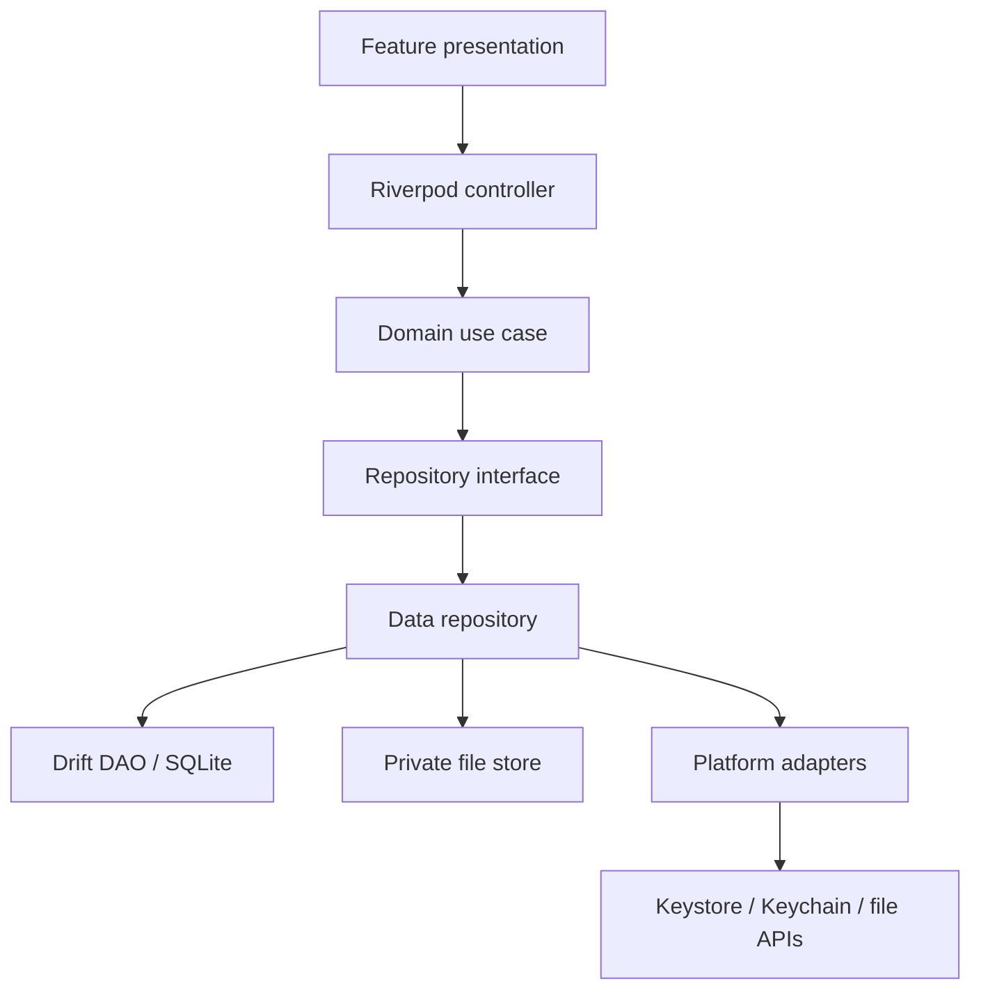

# System architecture

## Current implementation (verified)
`lib/main.dart` calls `bootstrap()`; bootstrap initializes Flutter binding and runs `ProviderScope(child: YaminttoApp())`; app builds `MaterialApp.router` with `AppTheme.light/dark`, `ThemeMode.system` and `appRouter`; GoRouter maps only `/` to FoundationScreen. `AppException` is sealed with only `UnexpectedAppException`. One widget test checks the foundation screen. No DB, repository, feature controller, domain model or native adapter exists.

## Planned architecture

- Startup: binding -> environment/config validation -> dependency composition -> root ProviderScope -> router/app. Add async initialization only for a concrete service; expose recoverable initialization errors.
- Feature boundaries: each feature owns presentation/domain/data. Core contains genuinely shared services. Avoid god-services and cross-feature private imports.
- State: Riverpod owns UI-facing async state and DI. Domain use cases own business operations; widgets do not run persistence/security workflows.
- Data flow: widget intent -> controller -> use case -> repository contract -> data repository -> Drift/file/native adapter -> domain result -> state update.
- Repository: map rows to domain, coordinate DAOs/transactions, paginate/query, translate failures; no UI or navigation.
- DB access: DAOs are SQL boundary; no widget/controller imports generated tables. Multi-record writes use transactions.
- Native adapters: narrow Dart interfaces for Keystore/BiometricPrompt, Keychain/LocalAuthentication, document providers and lifecycle. Shared domain must not import platform APIs.
- DI: root providers compose DB/repositories/adapters; feature providers depend on abstractions and can be overridden in tests. Avoid service locator/global mutable state.
- Tests: domain/repo with fakes or in-memory DB; widget with provider overrides; integration with real DB/files/router; physical devices for hardware security.
This is target architecture, not implemented architecture.
